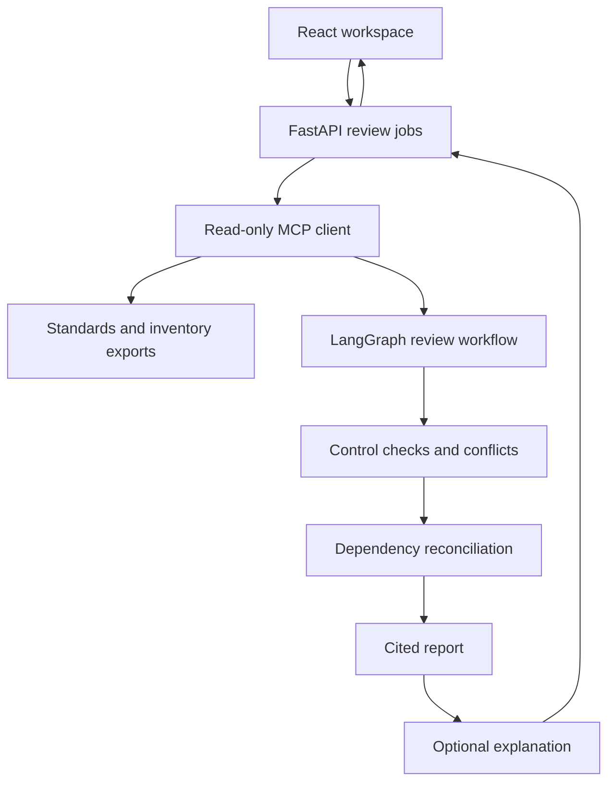

# How it fits together

The UI sends a validated design to FastAPI and receives a job ID immediately. It polls that job, can reconnect after a network error, and can cancel through the API. Closing a browser connection does not cancel the server job; explicit cancellation does.

## Evidence boundary

Each review starts a fixed local MCP server and reads `read_standards` and `read_inventory`. Both declare `readOnlyHint=true` and `destructiveHint=false`. There are no mutation tools, arbitrary path parameters, shell inputs, or tool names accepted from the browser. Pydantic validates the normalized snapshot before it enters the graph.

The data directory is operator configured. This is a local export adapter, not a live LeanIX connection. Reads are sequential; concurrent edits to the files are not an atomic snapshot. Keep a versioned export directory immutable for the lifetime of a review deployment.

## Review logic

The compiled `StateGraph` checks controls, reconciles dependencies, and builds a report. Standards apply by component kind. Multiple expected values for the same control are a conflict, regardless of the declared value. Missing values produce evidence gaps. Matching values count as passing declarations, never verified implementation evidence.

Dependency checks compare each component with the inventory: omitted source dependencies, unresolved design references, absent inventory applications, ownership, and lifecycle. Findings about absence have no invented citation; the UI labels their origin as the design or absence in the loaded inventory. Inventory citations carry the export timestamp and a JSON pointer. Standard citations carry the supplied excerpt and revision.

The optional model receives the computed report, cannot mutate findings, and must return known citation IDs. This constrains references, not semantic correctness. Failure preserves the deterministic review and adds an explicit trace entry.

## Execution and limits

The process retains up to 200 jobs, admits at most 12 unfinished jobs, and runs four reviews concurrently. Evidence reads time out after 30 seconds and the entire review after 60 seconds. Bodies over 256 KB are rejected; schema limits cap components, dependencies, and narrative length. Logs include source errors for operators; browser errors are sanitized.

Cancellation awaits the running task's cleanup before returning. A queued task cancelled before its first instruction is marked cancelled explicitly. Completed jobs remain completed. A report is published only after the graph and optional explanation finish.

There is no durable queue, resume checkpoint, login, tenant isolation, or distributed coordination. One API worker is required. The API and built UI share an origin; the development server uses a Vite proxy. Docker binds the API to the container interface; the README publishes the host port on localhost.

## API

| Method | Path | Result |
| --- | --- | --- |
| GET | `/api/health` | Process health, not source readiness |
| GET | `/api/example` | Fictional example design |
| POST | `/api/reviews` | 202 with queued review ID |
| GET | `/api/reviews/{id}` | State, error, or completed report |
| DELETE | `/api/reviews/{id}` | Cancel active work; idempotent for terminal jobs |

A 404 can mean an unknown, evicted, or pre-restart job. A 429 means the bounded queue is full. A 422 describes invalid submission fields. FastAPI's `/docs` documents schemas.
